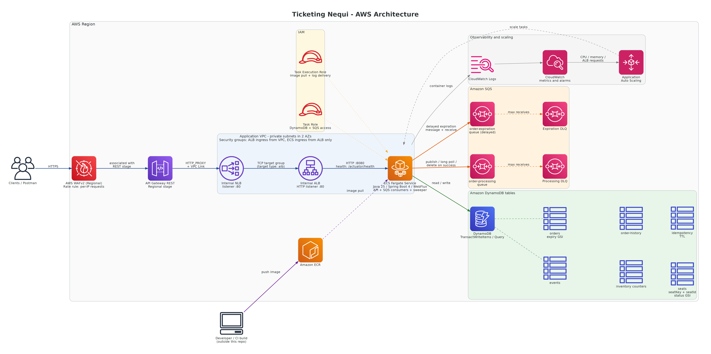
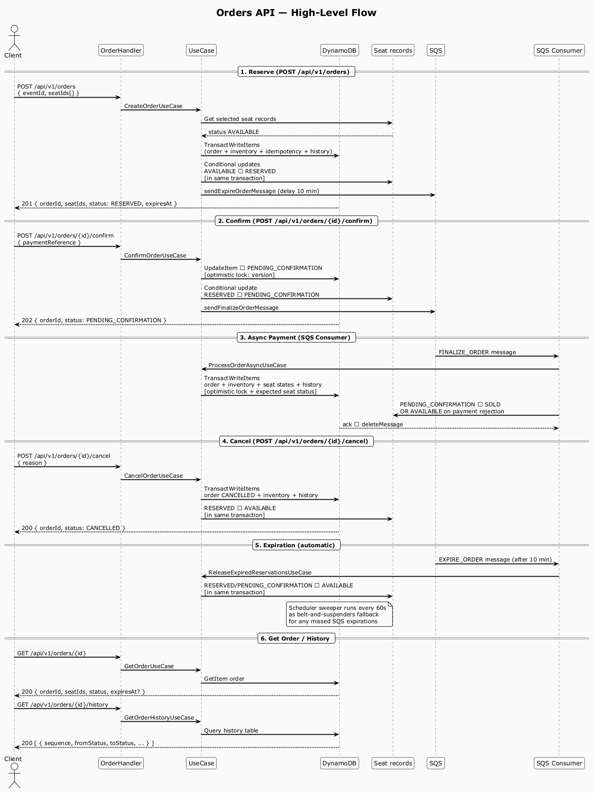

# 🎟️ App Ticketing Nequi — Reactive Ticket Purchase System

High-performance, high-concurrency ticketing microservice built with **Java 25**, **Spring Boot 4.x**, **Spring WebFlux**, **AWS DynamoDB** and **Amazon SQS**, following **Bancolombia Clean Architecture**.

The service reserves numbered seats transactionally, processes payment confirmation asynchronously, and releases expired reservations. Local development uses LocalStack. Terraform describes AWS infrastructure, while the checked-in environment files target Floci for local validation.

**Contents:** [Architecture](#architecture-overview) · [Quick start](#quick-start-with-docker) · [API](#api-reference) · [Tests](#tests-and-coverage) · [Project structure](#project-structure) · [Terraform](#infrastructure-terraform) · [Diagrams](#diagrams)

---

## 🏗️ Architecture Overview

```
RouterRest → EventHandler / OrderHandler → ValidationHelper → UseCase → Adapters (DynamoDB / SQS)
```

| Layer | Responsibility |
|---|---|
| `entry-points/reactive-web` | HTTP routing, request/response mapping, circuit breakers |
| `domain/usecase` | Business logic, orchestration, state machine |
| `domain/model` | Entities, enums, gateway interfaces |
| `driven-adapters/dynamodb-reactive` | DynamoDB persistence with conditional writes |
| `driven-adapters/sqs-sender` | Async event publishing to SQS |
| `driven-adapters/sqs-listener` | At-least-once SQS consumer |

[](docs/arquitectura/ticketing-aws-architecture.png)

Related diagrams: [Local development architecture](docs/arquitectura/ticketing-local-dev-architecture.png) · [Mermaid sources and notes](docs/arquitectura/architecture.md).

---

## 🔄 Order Lifecycle

[](docs/diagramas-secuencia/orders_flow.png)

[PlantUML source](docs/diagramas-secuencia/orders_flow.puml)

The sequence diagram shows the main order states and transitions across reservation, confirmation, asynchronous payment, cancellation, expiration, and order history lookup. Order creation reserves inventory synchronously; payment finalization runs asynchronously after confirmation.

States `SOLD`, `COMPLIMENTARY`, `CANCELLED` and `EXPIRED` are **terminal** — no transitions out.

---

## 📝 Technical Documentation

Technical documentation is included as design notes in [docs/technical-documentation.md](docs/technical-documentation.md).

Use this document to review the architectural decisions, concurrency strategy, async processing model, and production trade-offs behind the implementation.

---

## 🚀 Quick Start with Docker

### Prerequisites
- **Docker** and **Docker Compose**
- **Java 25** (to build the JAR locally; the Gradle wrapper is included)

The Gradle commands below use `./gradlew` for macOS/Linux. In Windows PowerShell, use `.\gradlew.bat` instead.

### 1. Build the JAR locally

The Docker image does **not** compile the project; it packages a pre-built JAR. Build the application before starting Docker:

```bash
./gradlew bootJar -x test
```

This produces `applications/app-service/build/libs/app-ticketing-nequi.jar`.

> If you skip this step, Docker will fail with:
> `COPY failed: no files found for applications/app-service/build/libs/*.jar`

### 2. Grant execute permission to the init script (macOS/Linux only)

The LocalStack initialization script must be executable before Docker mounts it:

```bash
chmod +x deployment/init-aws.sh
```

> If you skip this step on macOS/Linux, LocalStack will start but tables and queues will **not** be created, and the app will fail to connect.

### 3. Start the full environment

The following Docker Compose commands work in PowerShell, macOS, and Linux:

```console
docker compose down
docker compose up --build -d
```

`down` removes containers from a previous run. LocalStack persistence is disabled, so local DynamoDB/SQS data is not retained when the container is removed.

If LocalStack does not execute its initialization script on Windows, normalize the line endings in `deployment/init-aws.sh` with PowerShell:

```powershell
$content = [System.IO.File]::ReadAllText("$PWD\deployment\init-aws.sh")
$content = $content -replace "`r`n", "`n"
[System.IO.File]::WriteAllText("$PWD\deployment\init-aws.sh", $content, [System.Text.UTF8Encoding]::new($false))
```

You do not need to run `init-aws.sh` manually. LocalStack executes it automatically when the container starts.

This starts:
- **LocalStack** — emulates DynamoDB (6 tables) and SQS (2 queues + 2 DLQs) on port `4566`
- **App Ticketing Nequi** — reactive microservice on port `8080`

Startup time depends on the machine and Docker image cache. Wait until both services are healthy; inspect status and logs with:

```console
docker compose ps -a
docker compose logs --tail=100
```

### Rebuild after code changes

```bash
docker compose down
./gradlew bootJar
docker compose up --build -d
```
### Stop

```bash
docker compose down
```

---

## ⚙️ Environment Variables

| Variable | Default | Description |
|---|---|---|
| `SERVER_PORT` | `8080` | HTTP port |
| `AWS_REGION` | `us-east-1` | AWS region |
| `AWS_ACCESS_KEY_ID` | `test` | AWS access key (LocalStack) |
| `AWS_SECRET_ACCESS_KEY` | `test` | AWS secret key (LocalStack) |
| `AWS_DYNAMODB_ENDPOINT` | `http://localhost:4566` | DynamoDB endpoint |
| `AWS_SQS_ENDPOINT` | `http://localhost:4566` | SQS endpoint |
| `TABLE_EVENTS` | `ticketing-events` | Events table name |
| `TABLE_INVENTORY` | `ticketing-inventory` | Aggregate inventory table name |
| `TABLE_SEATS` | `ticketing-seats` | Individual seats table name |
| `TABLE_ORDERS` | `ticketing-orders` | Orders table name |
| `TABLE_ORDER_HISTORY` | `ticketing-order-history` | Audit history table |
| `TABLE_IDEMPOTENCY` | `ticketing-idempotency` | Idempotency table |
| `AWS_SQS_PROCESSING_QUEUE_URL` | `http://localhost:4566/000000000000/order-processing-queue` | Finalize order queue |
| `AWS_SQS_EXPIRATION_QUEUE_URL` | `http://localhost:4566/000000000000/order-expiration-queue` | Expiration queue |
| `AWS_SQS_POLL_INTERVAL_MS` | `5000` | SQS polling interval (ms) |
| `EXPIRED_RESERVATIONS_INTERVAL_MS` | `60000` | Scheduler sweep interval (ms) |
| `CB_SLIDING_WINDOW_SIZE` | `10` | Circuit breaker window size |
| `CB_MIN_CALLS` | `5` | Minimum calls before CB evaluates |
| `CB_FAILURE_RATE_THRESHOLD` | `50` | Failure % to open circuit |
| `CB_WAIT_DURATION_OPEN` | `30s` | Time in open state |
| `CB_SLOW_CALL_DURATION` | `10s` | Slow call threshold |

The default AWS credentials and LocalStack endpoints are for local development only. Do not use the `test` credentials or these endpoint defaults to connect to AWS.

---

## 📡 API Reference

All responses follow the envelope:
```json
{
  "statusCode": "0",
  "description": "SUCCESS",
  "data": { ... }
}
```

### Events

#### Create Event — `POST /api/v1/events`
Requires `X-Role: ADMIN`.

```bash
curl -X POST http://localhost:8080/api/v1/events \
  -H "Content-Type: application/json" \
  -H "X-Role: ADMIN" \
  -H "X-Trace-Id: trace-001" \
  -d '{
    "name": "Concierto Shakira 2026",
    "eventDate": "2026-11-15T20:00:00Z",
    "venue": "Estadio El Campín",
    "category": "CONCERT",
    "totalCapacity": 50000,
    "ticketPrice": 150000.00
  }'
```

#### List Events — `GET /api/v1/events`

```bash
curl "http://localhost:8080/api/v1/events?limit=10"
```

#### Get Event Detail and Current Availability — `GET /api/v1/events/{eventId}`

```bash
curl http://localhost:8080/api/v1/events/<EVENT_ID>
```

The detail response includes aggregate availability and `availableSeatIds`; choose IDs from this list when creating an order. The seat list comes from a DynamoDB secondary index and can be briefly stale; the reservation transaction is the final availability check.

The cURL examples in this section use Bash line continuations. In Windows PowerShell, import the Postman collection or use `curl.exe` and replace each trailing `\` with a PowerShell backtick.

#### Inspect Seat Status in DynamoDB LocalStack

To inspect each seat and its current status for an event, run this PowerShell command from the repository root. Replace `<EVENT_ID>` with the event ID returned by `POST /api/v1/events`:

```powershell
docker compose exec localstack awslocal dynamodb scan `
  --table-name ticketing-seats `
  --filter-expression "eventId = :eventId" `
  --expression-attribute-values '{":eventId":{"S":"<EVENT_ID>"}}' `
  --projection-expression "eventId, seatId, #status, orderId, updatedAt" `
  --expression-attribute-names '{"#status":"status"}' `
  --output table
```

The output includes the seat ID, its status (`AVAILABLE`, `RESERVED`, `PENDING_CONFIRMATION`, `SOLD` or `COMPLIMENTARY`), the associated order ID when applicable, and the last update time. The command uses `scan`, which is convenient for local inspection but reads the table; for large production tables, query the `gsi-seats-by-status` index using the event, status and seat shard instead.

### Orders

#### Create Order (Reserve) — `POST /api/v1/orders`
Requires `Idempotency-Key` header.

```bash
curl -X POST http://localhost:8080/api/v1/orders \
  -H "Content-Type: application/json" \
  -H "Idempotency-Key: unique-client-key-001" \
  -H "X-User-Id: usr-client-001" \
  -H "X-Trace-Id: trace-order-001" \
  -d '{
    "eventId": "<EVENT_ID>",
    "seatIds": ["S-00001", "S-00002"]
  }'
```

Returns HTTP `201` with the selected IDs and an order in `RESERVED` state. Reservations expire in **10 minutes**. Requests must contain 1 to 10 distinct seat IDs.

The `Idempotency-Key` is scoped to the user and operation. Repeating the same key with the same request body returns the existing order; reusing it with a different body is rejected. Idempotency records expire after 24 hours.

#### Get Order Status — `GET /api/v1/orders/{orderId}`

```bash
curl http://localhost:8080/api/v1/orders/<ORDER_ID> \
  -H "X-User-Id: usr-client-001"
```

#### Confirm Order (Trigger Payment) — `POST /api/v1/orders/{orderId}/confirm`

```bash
curl -X POST http://localhost:8080/api/v1/orders/<ORDER_ID>/confirm \
  -H "Content-Type: application/json" \
  -H "X-User-Id: usr-client-001" \
  -d '{ "paymentReference": "tok_card_visa_123" }'
```

Returns HTTP `202` with state `PENDING_CONFIRMATION`. Confirmation starts a **5-minute** processing window, and payment is processed asynchronously via SQS. Poll `GET /api/v1/orders/{orderId}` to check the result (`SOLD`, `CANCELLED` or, if the window expires, `EXPIRED`).

The current `PaymentGateway` is a mock: it approves any reference except `REJECT_PAYMENT`. Use that value to demonstrate a rejected payment, which should release the reserved seats and leave the order `CANCELLED`. This is not a real payment integration.

#### Cancel Order — `POST /api/v1/orders/{orderId}/cancel`

```bash
curl -X POST http://localhost:8080/api/v1/orders/<ORDER_ID>/cancel \
  -H "Content-Type: application/json" \
  -H "X-User-Id: usr-client-001" \
  -d '{ "reason": "CUSTOMER_REQUEST" }'
```

Cancellation is currently supported only while the order is `RESERVED`.

#### Get Order Audit History — `GET /api/v1/orders/{orderId}/history`

```bash
curl http://localhost:8080/api/v1/orders/<ORDER_ID>/history \
  -H "X-User-Id: usr-client-001"
```

#### Issue Complimentary Tickets — `POST /api/v1/events/{eventId}/complimentary`
Requires `X-Role: ADMIN` and `Idempotency-Key`.

```bash
curl -X POST http://localhost:8080/api/v1/events/<EVENT_ID>/complimentary \
  -H "Content-Type: application/json" \
  -H "X-Role: ADMIN" \
  -H "Idempotency-Key: comp-key-001" \
  -d '{
    "seatIds": ["S-00003", "S-00004"],
    "recipient": "Prensa VIP",
    "reason": "Promoción Medios"
  }'
```

---

## 🔐 Security Headers

Every response includes:

| Header | Value |
|---|---|
| `Content-Security-Policy` | `default-src 'self'; frame-ancestors 'self'; form-action 'self'` |
| `Strict-Transport-Security` | `max-age=31536000; includeSubDomains; preload` |
| `X-Content-Type-Options` | `nosniff` |
| `Cache-Control` | `no-store` |
| `Referrer-Policy` | `strict-origin-when-cross-origin` |

These headers are browser-facing hardening and do not authenticate callers. In this exercise, `X-User-Id` and `X-Role` are demo headers and must not be trusted as identity in a production deployment; use a validated JWT or trusted authorizer instead.

---

## 🧪 Tests and Coverage

The suite separates unit tests from tests tagged `integration`:

| Layer | Command | Needs Docker | What it covers |
|---|---|---|---|
| Unit tests | `./gradlew test` | No | Use cases, handlers, mappers, adapters with mocked AWS SDK, ArchUnit |
| Integration tests | `./gradlew integrationTest` | **Yes** | DynamoDB transaction and conditional-write behavior in LocalStack via **Testcontainers** |

### Run unit tests

```bash
./gradlew test
```

### Run integration tests (Testcontainers + LocalStack)

Requirements: Docker running (Docker Desktop on Windows/macOS). Testcontainers starts and removes the LocalStack container automatically; you do **not** need `docker compose` for these tests. If Docker is unavailable, these integration tests fail; they are not configured to skip automatically.

```bash
./gradlew integrationTest
```

The first run downloads `localstack/localstack:3.4`, `testcontainers/ryuk` and `alpine`, so it can take a few minutes. Later runs take around 15-30 seconds.

**Concurrency test** (`DynamoDBConcurrencyLocalStackTest`): launches 30 concurrent reservation attempts for 10 tickets. It asserts that exactly 10 succeed, the other 20 are rejected, and the final inventory is `available = 0`, `reserved = 10`. This exercises conditional writes and `TransactWriteItems` against LocalStack; it is not a test against AWS itself or a load test of the running HTTP service.

### Coverage report and verification

```bash
./gradlew test jacocoMergedReport --no-configuration-cache
./gradlew integrationTest
./gradlew jacocoMergedVerification --no-configuration-cache
```

- Run `integrationTest` first so its execution data is available to the merged report.
- `jacocoMergedVerification` runs the unit tests/report tasks and **fails the build** if the configured coverage threshold is below 90 %.
- The coverage threshold excludes the data/configuration packages listed below; report the result only after this verification task passes.
- `--no-configuration-cache` is required due to a known incompatibility between the pitest plugin and Gradle 9's configuration cache.

Report available at `build/reports/jacocoHtml/index.html`:

```bash
# Windows
start build/reports/jacocoHtml/index.html

# macOS
open build/reports/jacocoHtml/index.html

# Linux
xdg-open build/reports/jacocoHtml/index.html
```

Classes excluded from the coverage metric: `MainApplication`, `config`, `mapper` (MapStruct generated), `entity`, `dto`, `enums`, `exception` and `model` packages (data carriers without logic).

### Mutation testing (optional)

```bash
./gradlew pitest pitestReportAggregate --no-configuration-cache
```

Integration tests (`@Tag("integration")`) are excluded from mutation testing because starting a container for every mutant makes it extremely slow.

### What the test suite covers

- All use cases with Mockito mocks and `StepVerifier`
- All DynamoDB adapters with mocked AWS SDK clients
- **Concurrency and transactional integrity against LocalStack (Testcontainers)**
- Handler endpoints via `WebTestClient`
- Security headers via `ConfigTest`
- Architecture rules via ArchUnit

---

## 📁 Project Structure

```
├── applications/app-service        # Spring Boot entry point, config beans
├── domain/
│   ├── model                       # Entities, enums, gateway interfaces
│   └── usecase                     # Business logic (no framework dependencies)
├── infrastructure/
│   ├── driven-adapters/
│   │   ├── dynamodb-reactive        # DynamoDB adapters with conditional writes
│   │   ├── sqs-sender               # SQS event publisher
│   │   └── sqs-listener             # SQS at-least-once consumer
│   └── entry-points/
│       └── reactive-web             # Handlers, router, filters, mappers
├── terraform/                       # Infrastructure as Code (AWS resources)
│   ├── dynamo/                      # DynamoDB tables (6 tables + GSIs)
│   ├── sqs/                         # SQS queues and DLQs
│   └── api/                         # ECR, ECS Fargate, ALB, API Gateway, IAM
├── docs/
│   ├── diagramas-secuencia/         # High-level sequence diagrams
│   │   ├── events_flow.puml         # Events API flow (PlantUML source)
│   │   ├── events_flow.png          # Events API flow (image)
│   │   ├── orders_flow.puml         # Orders API flow (PlantUML source)
│   │   └── orders_flow.png          # Orders API flow (image)
│   └── diagramas-flujo/             # Per-endpoint flow diagrams
│       ├── mermaid/                 # Mermaid source code (import in Lucidchart)
│       └── images/                  # Rendered diagram images
└── postman_collection.json          # Postman collection with all endpoints
```

---

## 🗂️ Postman Collection

A ready-to-use [Postman collection](postman_collection.json) is available at the repository root. Import it into Postman to access the configured endpoints, example request bodies, and headers (`X-Role`, `X-User-Id`, `Idempotency-Key`, etc.).

---

## 🏛️ Infrastructure (Terraform)

The `terraform/` folder contains the AWS infrastructure definition organized in three independent modules. Apply them in the order shown in the Terraform guide:

| Module | Resources |
|---|---|
| `terraform/dynamo/` | 6 DynamoDB tables with GSIs and TTL |
| `terraform/sqs/` | 2 SQS queues + 2 DLQs with redrive policy |
| `terraform/api/` | ECR, ECS Fargate, ALB + NLB, API Gateway REST, WAFv2, IAM roles, CloudWatch, Auto Scaling |

Each module has environment-specific files under `env/dev/`, `env/qa/` and `env/pdn/`. All checked-in tfvars target Floci and use a fake account ID; they are for local validation only and must not be used to deploy to AWS.

See [`terraform/README.md`](terraform/README.md) for deployment instructions.

### Run Terraform locally with Floci

With Docker Desktop running, start the AWS emulator and follow the three-module `dev` apply sequence in the Terraform guide:

```powershell
docker compose -f docker-compose.floci.yml up -d
```

Floci runs ECS in mock mode, so this validates resource configuration without starting the Java service. Its WAF API stores the Web ACL and association but does not filter live traffic. Validate rate limiting, networking, and permissions in AWS before treating them as production-ready.

---

## 📊 Diagrams

All diagrams are in the `docs/` folder.

### [High-level sequence diagrams](docs/diagramas-secuencia/)

Two PlantUML diagrams showing the interaction between layers at a high level:

| Diagram | Source | Image |
|---|---|---|
| Events API | `events_flow.puml` | `events_flow.png` |
| Orders API | `orders_flow.puml` | `orders_flow.png` |

### [Per-endpoint flow diagrams](docs/diagramas-flujo/)

Detailed flow diagram for each endpoint and the SQS consumer, showing business decisions, DynamoDB operations, error paths and HTTP responses:

| Endpoint | Mermaid source | Image |
|---|---|---|
| `POST /api/v1/events` | `mermaid/01-post-events.md` | `images/01-post-events.png` |
| `GET /api/v1/events` | `mermaid/02-get-events.md` | `images/02-get-events.png` |
| `GET /api/v1/events/{eventId}` | `mermaid/03-get-event-by-id.md` | `images/03-get-event-by-id.png` |
| `POST /api/v1/events/{eventId}/complimentary` | `mermaid/04-post-complimentary.md` | `images/04-post-complimentary.png` |
| `POST /api/v1/orders` | `mermaid/05-post-orders.md` | `images/05-post-orders.png` |
| `GET /api/v1/orders/{orderId}` | `mermaid/06-get-order-by-id.md` | `images/06-get-order-by-id.png` |
| `POST /api/v1/orders/{orderId}/confirm` | `mermaid/07-post-confirm-order.md` | `images/07-post-confirm-order.png` |
| `POST /api/v1/orders/{orderId}/cancel` | `mermaid/08-post-cancel-order.md` | `images/08-post-cancel-order.png` |
| `GET /api/v1/orders/{orderId}/history` | `mermaid/09-get-order-history.md` | `images/09-get-order-history.png` |
| SQS Consumer | `mermaid/10-sqs-consumer.md` | `images/10-sqs-consumer.png` |

The Mermaid files can be imported directly into **Lucidchart** to edit or regenerate the diagrams.
