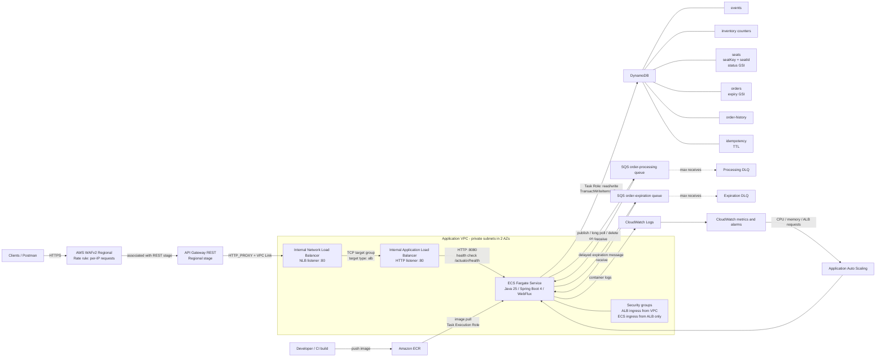
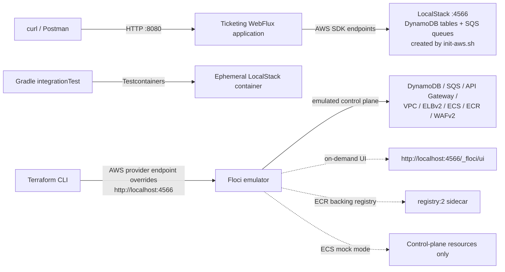

# Architecture

## AWS deployment

**Request path:** WAF protects the API Gateway stage; the REST VPC Link targets the NLB, which forwards to the internal ALB and ECS tasks. The NLB-to-ALB target attachment is supported by AWS. WAF's rate limit is keyed by source IP and does not replace application authentication, per-user controls, or idempotency.

**Purchase path:** the WebFlux service first reserves selected seats synchronously with a conditional DynamoDB transaction. It publishes expiration messages to SQS; confirmation publishes payment-finalization messages. The SQS consumer updates order, seat, inventory, and audit records transactionally, then acknowledges successful messages. A scheduled sweeper provides a second expiration path.

**IAM:** the ECS Task Role grants the application access to DynamoDB and SQS. The ECS Task Execution Role grants image-pull and log-delivery permissions. The API and load balancers are defined in Terraform; the CI/build system that pushes application images is not included in the current repository.

## Local development and infrastructure emulation

